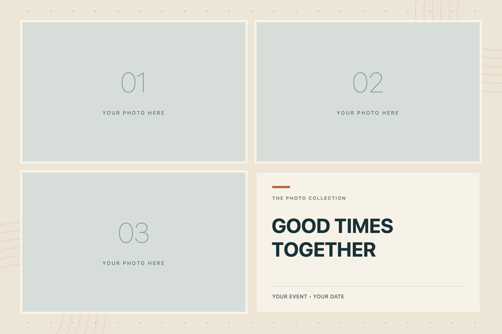

# Paperbooth

A native macOS photobooth for events. Mount an iPhone as the camera through Continuity Camera, and guests get three countdown shots composed into a printable 6 × 4-inch sheet with an event-title cell.



## What it does

- Takes three photos with a countdown before each shot, using any camera macOS can see (built for an iPhone through Continuity Camera).
- Composes them into an exact 1800 × 1200 px, 300 dpi JPEG: photos in three cells, event title or custom artwork in the fourth.
- Swappable artwork layers: background, title-cell art, and a transparent overlay drawn on top.
- Saves each session to its own timestamped folder: the finished sheet plus the three full-resolution photos.
- Prints through the system dialog at 6 × 4 inches (432 × 288 pt).
- Recovers from interruptions: completed shots are kept and **Continue** resumes the sequence.
- Works offline. No accounts, uploads, or cloud services.

Two built-in styles, **Midnight** and **Warm paper**, plus an example [Halloween theme](themes/halloween/).

## Build

Requires macOS 14+ on Apple Silicon and Xcode (for `swiftc`). No external packages.

```sh
./build.sh
open build/Paperbooth.app
```

The script compiles `Sources/*.swift` with `swiftc` and produces an ad-hoc-signed app. It is a local build, not notarized.

Run the rendering and export checks:

```sh
build/Paperbooth.app/Contents/MacOS/Paperbooth --self-test /tmp/Paperbooth-tests
```

## How it's built

SwiftUI and AppKit for the interface, AVFoundation for camera discovery and still capture, ImageIO for JPEG output with 300 dpi metadata.

| File | Role |
| --- | --- |
| `CameraController.swift` | Camera discovery and capture. Session operations and capture continuations run on a serial queue. |
| `BoothModel.swift` | Session state: shots, countdown, save, reset, settings. Updated on the main thread. |
| `SheetRenderer.swift` | Bitmap composition: center-cropped photo cells, title cell, artwork layers. |
| `PaperboothApp.swift` | App entry point and the booth interface. |
| `SelfTest.swift` | Automated checks for dimensions, dpi, ordering, cropping, overlays, and session export. |

Camera access is requested only when the user clicks **Enable camera**. Settings live in `UserDefaults` under `local.paperbooth.mac`.

## Before an event

iPhone capture and physical printing need a test with your own devices:

- Approve camera access and select the actual iPhone.
- Complete three shots; check framing, orientation, mirroring, and image quality.
- Disconnect and reconnect the camera, then check the retained shots and **Continue**.
- Cancel during a countdown and during a capture.
- Choose an output folder and confirm automatic export.
- Make one physical 6 × 4-inch print on the intended printer.

Full setup, artwork coordinates, and printing steps: [docs/USER-GUIDE.md](docs/USER-GUIDE.md).

## Scope

Paperbooth intentionally has no sharing service, accounts, freeform layout editor, printer-specific integration, or kiosk lock.
